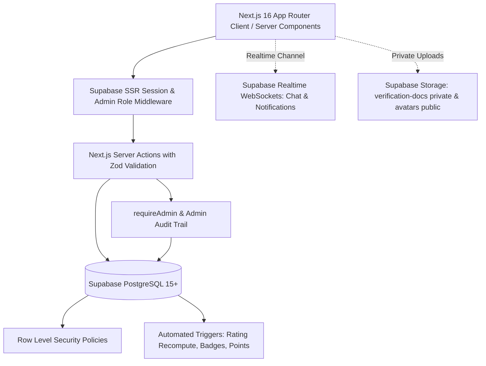
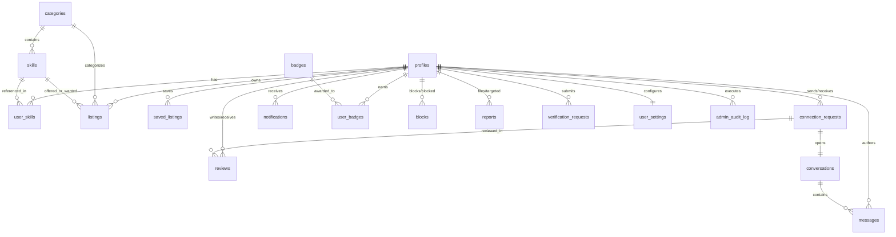

# Pairly — Peer-to-Peer Academic Skill Exchange Platform

> **"Share Skills. Help Others. Grow Together."**

Pairly is a university-level, currency-free peer skill exchange platform connecting students, educators, professionals, and community helpers. Instead of paying commercial tutoring fees, members exchange expertise directly: Person A teaches Skill X in return for learning Skill Y from Person B.

Pairly's core differentiator is its **Bilateral Smart Matching Engine**, which calculates harmonic mean compatibility scores (0–100%) between members based on mutual skill offerings and learning goals.

---

## Architecture Overview



---

## Entity Relationship (ER) Diagram



---

## Key Features

### 1. Smart Matching Algorithm
- **Bilateral Need Compatibility (Weight 60)**: Calculates harmonic mean between Forward match (what you want that they offer) and Reverse match (what they want that you offer). One-sided matches score low; mutual matches score up to 60.
- **Academic Persona Alignment (Weight 20)**: Prioritizes peer pairings (Student-to-Student, Teacher-to-Teacher, Professional-to-Professional).
- **Proximity & Delivery Mode (Weight 20)**: Scores online, in-person, or same-city matching.
- **Total Compatibility Score**: 0 to 100% match indicator on listings and peer profiles.

### 2. Complete Connection Lifecycle & Real-Time Chat
- **Status Lifecycle**: `Pending` &rarr; `Accepted` &rarr; Mutual `Completion Requested` &rarr; `Completed` (or `Declined`/`Cancelled`).
- **Real-Time Messaging**: Built on Supabase Realtime Channels with online presence indicators, optimistic updates, and unread badges.
- **Safety Tips Card**: Dismissible banner appearing in new chat threads advising campus public meeting locations.
- **Content Safety Filter**: Client & server check blocking banned keywords, harassment, and off-platform contact sharing (phone numbers, external emails) during first contacts.

### 3. Reviews & Reputation System
- **Mutual Exchange Requirement**: Reviews can only be submitted after both parties mutually confirm exchange completion.
- **Ratings & Sub-Ratings**: Interactive star rating (1–5 in Soft Lavender) plus optional sub-ratings (Skill Quality, Communication, Punctuality).
- **Automated Recomputation**: PostgreSQL triggers instantly recalculate average ratings and review counts on insert and deletion.

### 4. Gamification & Badges
- **Points Economy**:
  - +20 pts on completed exchange
  - +5 pts on giving a review
  - +10 pts on receiving a 5-star review
  - +50 pts on identity verification
- **Levels**: Level 1 (Newcomer, 0-99 pts) &rarr; Level 2 (Explorer, 100-199 pts) &rarr; Level 3 (Contributor, 200-299 pts) &rarr; Level 4 (Mentor, 300-499 pts) &rarr; Level 5 (Legend, 500+ pts).
- **Automated Badge Awarding**: `award_badges()` stored procedure awards seeded badges (First Exchange, Skill Sharer, Community Pillar, Five Star, Verified Member, Profile Pro, Helping Hand).
- **Leaderboard**: Top 20 scholars filtered by All Time and This Month.

### 5. Trust & Safety Infrastructure
- **Bilateral Blocking**: Blocked users are completely excluded in search, explore, smart matching, direct messaging, and connection requests.
- **Reporting Queue**: Users and listings can be flagged for Spam, Harassment, Inappropriate Content, Scam, or Fake Profile.
- **Student Identity Verification**: Upload Student ID or institutional credentials to private storage bucket (`verification-docs`) for admin review.

### 6. Full Administrator Dashboard (`/admin`)
- **Protected Access**: Role-based access control guarded by Next.js middleware, server-side `is_admin()` checks, and database RLS.
- **Analytics Overview**: KPI cards and Recharts visualizations (30-day user growth line chart, category bar chart, user type donut chart, top in-demand skills).
- **User Management**: Search, filter, verify scholar credentials, promote/demote admins, and suspend/reinstate accounts with reason dialogs.
- **Listing Moderation**: Close, restore, or remove policy-violating listings.
- **Reports Moderation**: Incident detail sheet with target history, admin notes, user suspension, and resolution notifications.
- **Verification Examination**: Private signed URL document preview with one-click approval (awards +50 points and badge) or rejection.
- **Reviews Moderation**: Delete fraudulent reviews with automatic rating recalculation.
- **Categories & Skills Management**: Full CRUD with safety check preventing deletion of active skills in use.
- **Audit Log**: Immutable audit trail recording every administrative decision.

### 7. User Settings (`/settings`)
- **Account Tab**: Update display name, username, email, password, and typed confirmation account deletion (`DELETE MY ACCOUNT`).
- **Appearance Tab**: Light, Dark, and System preview cards synced with `next-themes` and persisted to database.
- **Notifications Tab**: Individual switches for emails, requests, messages, and reviews.
- **Privacy & Safety Tab**: City visibility toggle, members-only mode, and blocked accounts management with unblock action.

### 8. Design System & Dark Mode
- **Palette**: Deep Purple (`#4B3F72`), Soft Lavender (`#A78BFA`), Mint Green (`#10B981` / `#A7F3D0`), Dark Navy (`#0F0B1A`), Crisp White (`#FFFFFF`).
- **Typography**: Plus Jakarta Sans (Headings) and Inter (Body).
- **Accessibility**: WCAG AA contrast compliance in both themes, visible focus rings in Soft Lavender, reduced-motion animation support, and tap targets &ge; 44px.

---

## Technology Stack

- **Framework**: Next.js 16 (App Router, Turbopack, Server Actions)
- **UI Library**: React 19, Tailwind CSS v4, Shadcn UI / Base UI, Lucide Icons
- **Database & Backend**: Supabase PostgreSQL 15+ with Row Level Security (RLS)
- **Realtime**: Supabase Realtime Channels (WebSockets)
- **Storage**: Supabase Storage (`verification-docs` private bucket, `avatars` public bucket)
- **Charts**: Recharts
- **Forms & Validation**: React Hook Form, Zod
- **Notifications**: Sonner toasts
- **Testing**: Vitest

---

## Getting Started

### 1. Prerequisites
- Node.js 20+ installed
- A Supabase project (cloud or local CLI)

### 2. Clone and Install
```bash
git clone https://github.com/your-username/pairly.git
cd pairly
npm install --legacy-peer-deps
```

### 3. Environment Variables
Create `.env.local` based on `.env.local.example`:
```env
NEXT_PUBLIC_SUPABASE_URL=https://your-project.supabase.co
NEXT_PUBLIC_SUPABASE_ANON_KEY=your-supabase-anon-key
```

### 4. Database Migrations
Apply migrations in numerical sequence in the Supabase SQL Editor or CLI:
1. `supabase/migrations/001_init.sql` (Enums, profiles, categories, skills, user_skills, RLS)
2. `supabase/migrations/002_seed.sql` (10 categories and 100+ standard academic skills)
3. `supabase/migrations/003_storage_and_onboarding.sql` (Avatars bucket and policies)
4. `supabase/migrations/004_listings.sql` (Listings table, view counters, saved listings)
5. `supabase/migrations/005_matching.sql` (Smart Matching algorithm RPCs and explore queries)
6. `supabase/migrations/006_connections_chat.sql` (Connection requests, realtime messages, notifications)
7. `supabase/migrations/007_reviews_gamification_safety.sql` (Reviews, badges, reporting, blocking, verification)
8. `supabase/migrations/008_admin_settings.sql` (User settings, admin audit log, moderation policies, analytics)

### 5. Seed the Demo Presentation Dataset
To populate 15 realistic scholars, 25 academic listings, completed exchanges, peer reviews, reports, and verification queues, run:
```bash
# In the Supabase SQL Editor:
Run supabase/seed_demo.sql
```

### 6. Promote an Account to Administrator
To access the Admin Console at `/admin`:
```sql
UPDATE public.profiles
SET role = 'admin'
WHERE username = 'YOUR_USERNAME';
```

### 7. Run the Development Server
```bash
npm run dev
```
Open [http://localhost:3000](http://localhost:3000) in your browser.

---

## Testing & Quality Assurance

Run the automated test suite:
```bash
npm test
```
Run production build:
```bash
npm run build
```

---

## Presentation Walkthrough

For a step-by-step 5-minute university presentation guide covering sign-up, onboarding, Smart Matching, live chat, exchange completion, reviews, gamification, and admin moderation, see [DEMO_SCRIPT.md](file:///f:/pairly/DEMO_SCRIPT.md).

For comprehensive security review and RLS policy documentation, see [SECURITY.md](file:///f:/pairly/SECURITY.md).
